# Diagramas del laboratorio (Mermaid para draw.io)

Topología, direccionamiento y flujos del laboratorio **VLSM, DHCP y
enrutamiento** en 3 sedes, listos para insertar en **draw.io**.

## Cómo usarlos en draw.io

Todos los bloques son **Mermaid estándar**, compatibles con el importador de
draw.io. El tipo de diagrama se detecta por la **primera palabra** del bloque
(`flowchart` o `sequenceDiagram`), así que copia siempre el bloque completo, con
su primera línea incluida.

Pasos para insertar uno:

1. Abre draw.io (app.diagrams.net o la app de escritorio).
2. **Arrange > Insert > Mermaid** (o el botón `+` de la barra de herramientas →
   **Mermaid**).
3. Copia el bloque del diagrama que quieras y pégalo en el cuadro de texto. En el
   desplegable inferior elige:
   - **Diagram** — lo convierte en formas nativas de draw.io: puedes recolorear,
     mover y seguir dibujando el lab encima (recomendado para el entregable).
   - **Image (SVG)** — inserta un solo objeto que conserva el código Mermaid;
     para re-editarlo, doble clic sobre la imagen.
4. Clic en **Insert**.

Los 11 diagramas son independientes: se pueden insertar todos en el mismo lienzo
y ordenarlos como láminas separadas. El **diagrama 7** (topología con VLANs) es
el indicado como base del entregable de la Sesión B.

| # | Diagrama | Tipo | Uso |
|---|----------|------|-----|
| 1 | Topología física completa | flowchart | Sesión A — interfaces y cables |
| 2 | Enlaces punto a punto y VLSM | flowchart | Sesión A — /30 y rutas estáticas |
| 3 | DHCP DORA | flowchart | Sesión A — negociación DHCP |
| 4 | Recorrido del paquete entre sedes | sequenceDiagram | Sesión A — ping PC-A1 → PC-C1 |
| 5 | Convergencia de OSPF | flowchart | Sesión B — vecindades de área 0 |
| 6 | Costes: primario vs respaldo | flowchart | Sesión B — `[110/2]` frente a `[110/102]` |
| 7 | Topología hub-and-spoke con VLANs | flowchart | Sesión B — base del entregable |
| 8 | La trampa del native VLAN | flowchart | Sesión B — gateway de la VLAN 10 |
| 9 | Router-on-a-stick | flowchart | Sesión B — subinterfaz `.20` |
| 10 | DHCP por VLAN | sequenceDiagram | Sesión B — pools VLAN 10 y 20 |
| 11 | Redundancia paso a paso | sequenceDiagram | Sesión B — prueba del respaldo |

> **Si draw.io reporta un error de parseo** (importadores antiguos): borra las
> líneas `classDef` y `class` del bloque —son **solo estilo**— y reintenta. Si aún
> falla, quita la línea `autonumber` en los `sequenceDiagram` y cambia las dobles
> flechas `<-->` por `---`.

---

## 1. Topología física completa (estilo Packet Tracer)

Los 3 routers en malla, cada uno con su switch y sus 3 PCs. Muestra qué interfaz
conecta con qué y la subred de cada enlace.

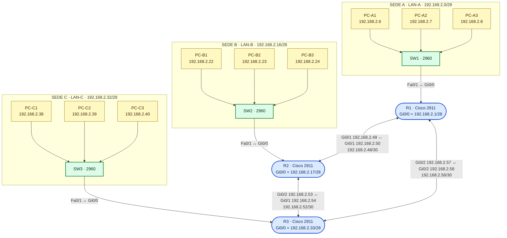

## 2. Malla de enlaces punto a punto y subredes VLSM

Solo la capa 3 entre routers: cada `/30` con sus dos extremos y el siguiente salto
de cada ruta estática.

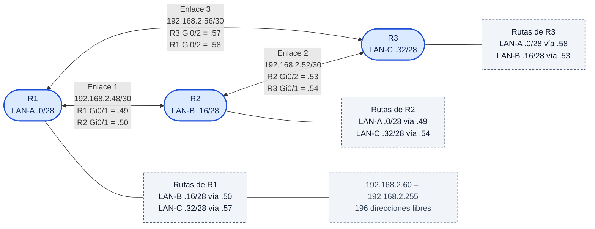

## 3. DHCP DORA — cómo un PC obtiene su IP

Flujo completo de la negociación entre un PC de LAN-A y el servidor DHCP que es
el propio router R1.

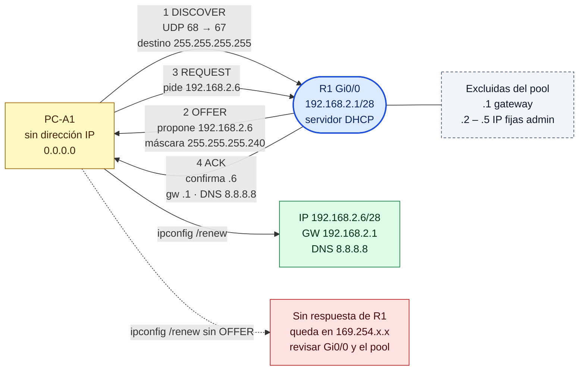

## 4. Recorrido de un paquete entre sedes

Traza de un `ping` de PC-A1 a PC-C1, que es el camino de 2 saltos directo de la
malla.

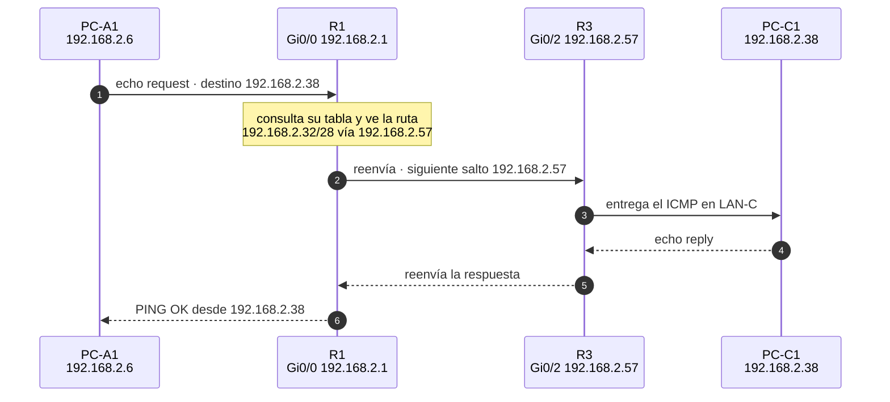

## 5. Convergencia de OSPF (Sesión B)

Los 3 routers en área 0 intercambian hellos, sincronizan la LSDB y ejecutan el
algoritmo SPF. Con roles hub-and-spoke (R1 central, R2/R3 sucursales) y el
enlace R2↔R3 como respaldo de costo alto, un uplink caído se recorre solo.

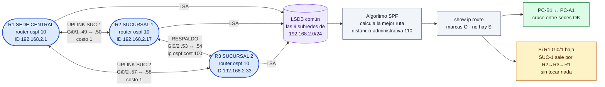

## 6. Sesión B — costes OSPF: primario frente a respaldo

El tráfico de una sucursal a la central usa su uplink directo (costo bajo); el
enlace entre sucursales queda dormido (`ip ospf cost 100`) hasta que cae un
uplink. Comparación de costos vistos desde R2.

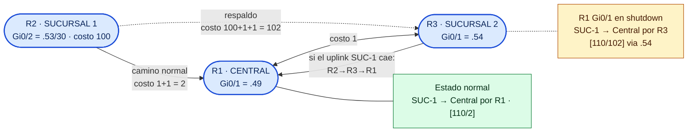

## 7. Sesión B — topología hub-and-spoke con VLAN 10 y 20

La estructura física es la misma de siempre (15 cables), pero los roles cambian:
R1 es la **sede central**, R2 y R3 son sucursales con su uplink, y el enlace
R2↔R3 queda como respaldo de costo alto. Cada sitio se parte en VLAN 10
(usuarios) y VLAN 20 (invitados).

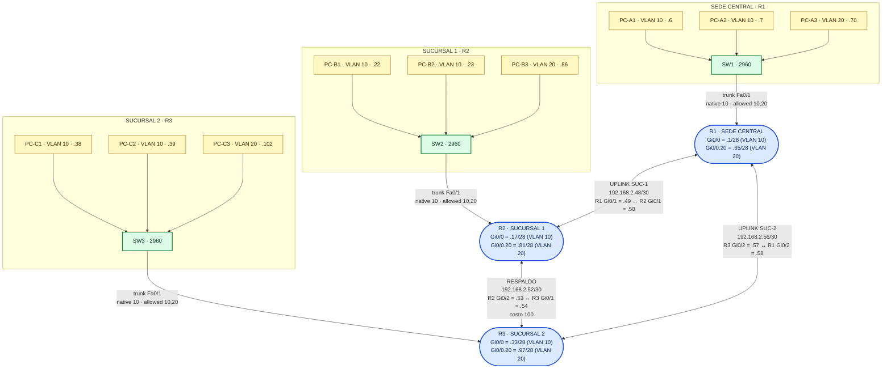

## 8. Sesión B — la trampa del native VLAN

La VLAN 10 viaja por el trunk **sin etiqueta** (es la nativa). Si no se fija,
la nativa por defecto es la VLAN 1 y el gateway de `Gi0/0` cae en una subred que
no existe: los PCs de la VLAN 10 no ven su ruteador.

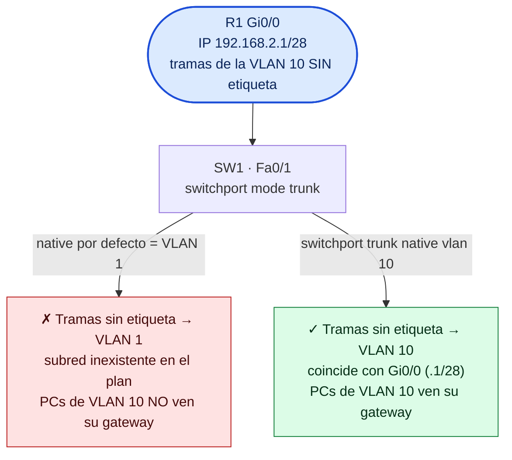

## 9. Sesión B — router-on-a-stick

Un solo cable entre cada router y su switch transporta las dos VLAN: la física
`Gi0/0` es el gateway de la VLAN 10 y la subinterfaz `Gi0/0.20` el de la 20.

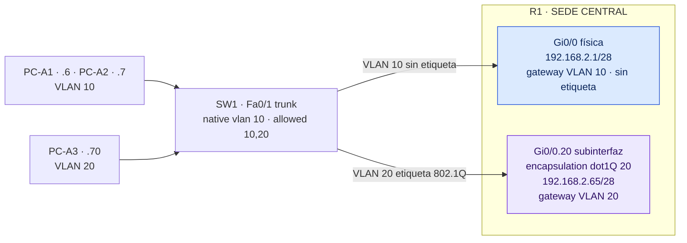

## 10. Sesión B — DHCP por VLAN

El mismo router sirve dos subredes porque tiene dos IP: el pool de la VLAN 10 y
el de la VLAN 20. Ejemplo con la sede central.

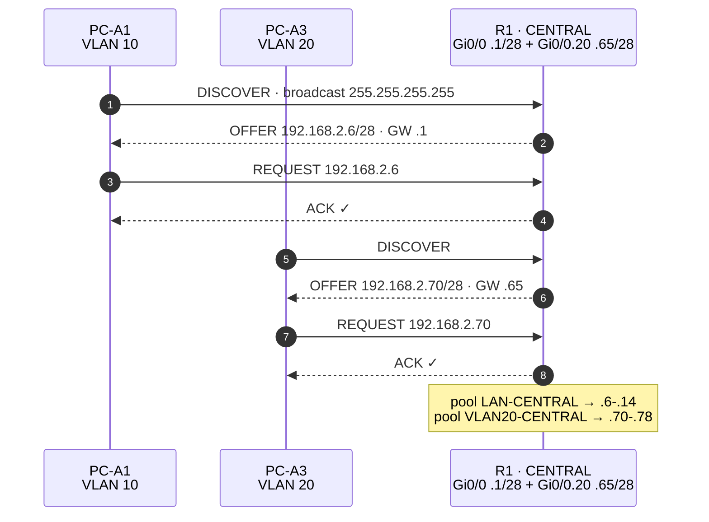

## 11. Sesión B — la prueba de redundancia paso a paso

Con el uplink de la sucursal 1 caído, el tráfico de PC-B1 a la central sale por
el respaldo (R2→R3→R1). OSPF recalculó solo.

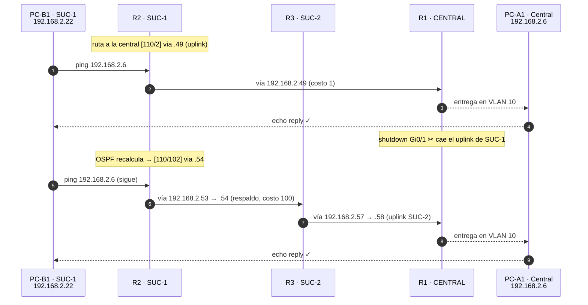

---

## Resumen del plan (para rotular a mano en el diagrama)

| Subred | Uso | Prefijo | Gateway | Rango DHCP | Broadcast |
|--------|-----|---------|---------|-----------|-----------|
| 192.168.2.0/28 | Central · VLAN 10 (usuarios) | 255.255.255.240 | .1 | .6 – .14 | .15 |
| 192.168.2.16/28 | SUC-1 · VLAN 10 | 255.255.255.240 | .17 | .22 – .30 | .31 |
| 192.168.2.32/28 | SUC-2 · VLAN 10 | 255.255.255.240 | .33 | .38 – .46 | .47 |
| 192.168.2.48/30 | Uplink SUC-1 · R1 ↔ R2 | 255.255.255.252 | — | — | .51 |
| 192.168.2.52/30 | Respaldo · R2 ↔ R3 | 255.255.255.252 | — | — | .55 |
| 192.168.2.56/30 | Uplink SUC-2 · R3 ↔ R1 | 255.255.255.252 | — | — | .59 |
| 192.168.2.64/28 | Central · VLAN 20 (invitados) | 255.255.255.240 | .65 | .70 – .78 | .79 |
| 192.168.2.80/28 | SUC-1 · VLAN 20 | 255.255.255.240 | .81 | .86 – .94 | .95 |
| 192.168.2.96/28 | SUC-2 · VLAN 20 | 255.255.255.240 | .97 | .102 – .110 | .111 |

> Los diagramas 1-4 reflejan la **Sesión A** (malla equivalente, 3 LAN, fases
> estática/OSPF). Los diagramas **5-11** son de la **Sesión B** (laboratorio
> independiente): el 5-6 muestran la convergencia y los costes OSPF, y el 7-11 el
> resto de la sesión — topología hub-and-spoke con VLANs, la trampa del native,
> router-on-a-stick, DHCP por VLAN y la prueba de redundancia. La estructura
> física y las IPs son las mismas; cambian los roles y el uso de cada enlace.