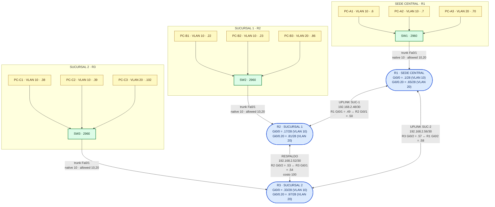
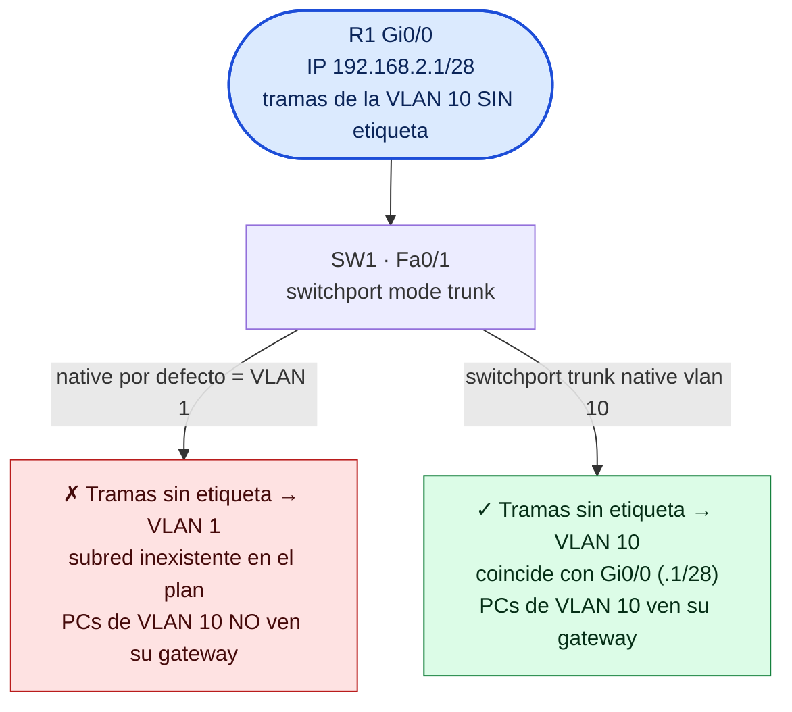
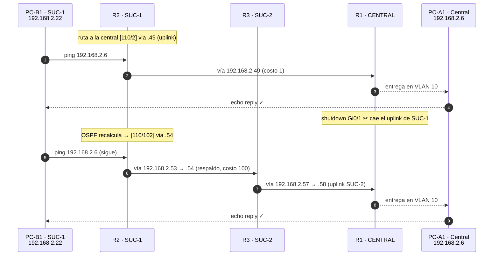

# Sesión B — Laboratorio independiente: sede central, sucursales, VLANs y OSPF

Laboratorio N.º 13 · Unidad III · **Cisco Packet Tracer**

> **Este laboratorio NO depende de la Sesión A.** No se hereda nada: se parte de
> equipos de fábrica y se construye una red corporativa completa con su propia
> topología, su plan de direccionamiento y su protocolo de enrutamiento.
>
> - Escenario: **sede central (R1)** con **dos sucursales (R2 y R3)**.
> - Cada sitio se segmenta con **VLAN 10 (usuarios)** y **VLAN 20 (invitados)**.
> - El enrutamiento es **OSPF área 0** desde el principio: **no hay rutas
>   estáticas**.
> - La sede central y las sucursales se enlazan por **uplinks directos** y hay un
>   **enlace de respaldo entre sucursales** para demostrar la redundancia.

Referencias: [`SUBNETEO.md`](SUBNETEO.md) (plan VLSM), [`COMANDOS.md`](COMANDOS.md)
(qué hace cada comando), [`DIAGRAMAS.md`](DIAGRAMAS.md) (diagramas Mermaid).

---

## Escenario

| Dispositivo | Rol | Sitios que conecta |
|-------------|-----|--------------------|
| R1 | **Sede central** | Su propia LAN + uplinks hacia R2 y R3 |
| R2 | **Sucursal 1** | Su propia LAN + uplink a R1 + respaldo a R3 |
| R3 | **Sucursal 2** | Su propia LAN + uplink a R1 + respaldo a R2 |
| SW1, SW2, SW3 | Switch de cada sitio | Los PCs del sitio, segmentados en VLAN 10 y 20 |
| 9 PCs | 3 por sitio | PC-A1…PC-A3 (central), PC-B1…PC-B3 (suc-1), PC-C1…PC-C3 (suc-2) |

Los tres enlaces entre routers:

| Enlace | Subred | Extremo A | Extremo B | Papel |
|--------|--------|-----------|-----------|-------|
| Uplink sucursal 1 | 192.168.2.48/30 | R1 Gi0/1 = .49 | R2 Gi0/1 = .50 | Camino **primario** de SUC-1 a la central |
| Respaldo entre sucursales | 192.168.2.52/30 | R2 Gi0/2 = .53 | R3 Gi0/1 = .54 | Camino **de emergencia** cuando cae un uplink |
| Uplink sucursal 2 | 192.168.2.56/30 | R3 Gi0/2 = .57 | R1 Gi0/2 = .58 | Camino **primario** de SUC-2 a la central |

```text
   SEDE CENTRAL (R1)                    SUCURSAL 1 (R2)              SUCURSAL 2 (R3)
   LAN usuarios .0/28  GW .1            LAN usuarios .16/28  GW .17   LAN usuarios .32/28  GW .33
   LAN invitados .64/28 GW .65          LAN invitados .80/28 GW .81   LAN invitados .96/28 GW .97
        │                                     │                             │
      SW1                                 SW2                             SW3
        │  Gi0/1 (.49)═══uplink 1═══Gi0/1 (.50)│
        │  Gi0/2 (.58)═════uplink 3═════Gi0/2 (.57)│
        │                        Gi0/2 (.53)═══respaldo═══Gi0/1 (.54)
```

La vista completa, con VLANs, trunks y las IP de cada extremo:



> En OSPF, el tráfico de una sucursal a la central usa su **uplink directo** (costo
> bajo) y el enlace entre sucursales queda como **respaldo** de costo alto (Parte 6).

---

## Parte 1 — Estado inicial

Todo debe arrancar **de fábrica**:

1. En los 3 routers: si traen configuración, límpiala:
   ```
   enable
   erase startup-config
   reload
   ```
   Responde `yes` cuando pregunte. Queda como equipo nuevo sin configurar.
2. Los switches 2960 y los PCs no traen configuración por defecto: no hace falta
   tocarlos todavía.
3. Comprueba que las interfaces GigabitEthernet de los 2911 nacen apagadas
   (luces rojas): es normal, se encienden con `no shutdown` en la Parte 4.

## Parte 2 — Montar la topología

### Paso 2.1 — Dispositivos

| Cant. | Dispositivo | Nombre en Packet Tracer |
|-------|-------------|-------------------------|
| 3 | `Router 2911` | R1, R2, R3 |
| 3 | `Switch 2960` | SW1, SW2, SW3 |
| 9 | `PC-PT` | PC-A1…PC-A3, PC-A4…PC-B3, PC-C1…PC-C3 |

Distribución de los PCs:

| Sitio | VLAN 10 (usuarios) | VLAN 20 (invitados) |
|-------|--------------------|--------------------|
| Central (SW1) | PC-A1, PC-A2 | PC-A3 |
| Sucursal 1 (SW2) | PC-B1, PC-B2 | PC-B3 |
| Sucursal 2 (SW3) | PC-C1, PC-C2 | PC-C3 |

### Paso 2.2 — Cableado (15 cables, todo Copper Straight-Through)

**a) Gateways a los switches** (3):

| Desde | Hasta |
|-------|-------|
| `R1 Gi0/0` | `SW1 Fa0/1` |
| `R2 Gi0/0` | `SW2 Fa0/1` |
| `R3 Gi0/0` | `SW3 Fa0/1` |

**b) Los 9 PCs a su switch** (9):

| Desde | Hasta | | Desde | Hasta | | Desde | Hasta |
|-------|-------|---|-------|-------|---|-------|-------|
| `PC-A1 Fa0` | `SW1 Fa0/2` | | `PC-B1 Fa0` | `SW2 Fa0/2` | | `PC-C1 Fa0` | `SW3 Fa0/2` |
| `PC-A2 Fa0` | `SW1 Fa0/3` | | `PC-B2 Fa0` | `SW2 Fa0/3` | | `PC-C2 Fa0` | `SW3 Fa0/3` |
| `PC-A3 Fa0` | `SW1 Fa0/4` | | `PC-B3 Fa0` | `SW2 Fa0/4` | | `PC-C3 Fa0` | `SW3 Fa0/4` |

**c) Los 3 enlaces entre routers** (3), directos, sin switch:

| Desde | Hasta | Subred | Papel |
|-------|-------|--------|-------|
| `R1 Gi0/1` | `R2 Gi0/1` | 192.168.2.48/30 | Uplink SUC-1 |
| `R2 Gi0/2` | `R3 Gi0/1` | 192.168.2.52/30 | Respaldo |
| `R3 Gi0/2` | `R1 Gi0/2` | 192.168.2.56/30 | Uplink SUC-2 |

Cuando Packet Tracer pregunte el tipo de cable entre routers, elige **Copper
Straight-Through** (crossover también valdría: las Gi del 2911 negocian auto-MDIX).

### Paso 2.3 — Comprobación del cableado

Los cables saldrán **rojos** hasta que se ejecute `no shutdown` (Parte 4). No es
un error. Verifica solo:

1. Cursor sobre cada cable: muestra `Device / Port` en ambos extremos.
2. Cada router tiene 3 cables (uno en cada Gi0/0, Gi0/1, Gi0/2).
3. Cada switch tiene 4 cables: `Fa0/1` (router) y `Fa0/2-4` (los 3 PCs).

---

## Parte 3 — Plan VLSM (guía de referencia)

La tabla está **dada**: el desarrollo completo del cálculo está en
[`SUBNETEO.md`](SUBNETEO.md). Verifica que cualquier IP que escribas cae dentro
de su rango.

| Subred | Red | Hosts útiles | Broadcast | Uso |
|--------|-----|--------------|-----------|-----|
| 192.168.2.0/28 | .0 | .1 – .14 | .15 | Central · VLAN 10 (usuarios) · GW .1 |
| 192.168.2.16/28 | .16 | .17 – .30 | .31 | SUC-1 · VLAN 10 · GW .17 |
| 192.168.2.32/28 | .32 | .33 – .46 | .47 | SUC-2 · VLAN 10 · GW .33 |
| 192.168.2.48/30 | .48 | .49 – .50 | .51 | Uplink SUC-1 (R1–R2) |
| 192.168.2.52/30 | .52 | .53 – .54 | .55 | Respaldo (R2–R3) |
| 192.168.2.56/30 | .56 | .57 – .58 | .59 | Uplink SUC-2 (R3–R1) |
| 192.168.2.64/28 | .64 | .65 – .78 | .79 | Central · VLAN 20 (invitados) · GW .65 |
| 192.168.2.80/28 | .80 | .81 – .94 | .95 | SUC-1 · VLAN 20 · GW .81 |
| 192.168.2.96/28 | .96 | .97 – .110 | .111 | SUC-2 · VLAN 20 · GW .97 |
| .112 – .255 | — | — | — | Reservado para crecimiento |

> Las subredes de las VLAN 20 (`.64`, `.80`, `.96`) empiezan en **múltiplos de
> 16** y encajan después de los tres enlaces `/30` (`.48`–`.59`).

---

## Parte 4 — Switches: VLAN 10 y 20

Cada sitio se parte en dos dominios de broadcast. El primer paso es crear las
VLAN y asignar los puertos.

### Paso 4.1 — Crear las VLAN (en SW1; haz lo equivalente en SW2 y SW3)

```text
enable                     ! modo privilegiado
configure terminal          ! modo de configuración global
vlan 10                    ! crea la VLAN de usuarios
 name USUARIOS-CENTRAL     ! etiqueta; no afecta al tráfico
vlan 20                    ! crea la VLAN de invitados
 name INVITADOS-CENTRAL    ! nombre de la VLAN nueva de este sitio
end                        ! vuelve al modo privilegiado
copy running-config startup-config
```

### Paso 4.2 — Puertos acceso y trunk (SW1)

```text
configure terminal
interface FastEthernet0/2   ! PC-A1
 switchport mode access
 switchport access vlan 10
interface FastEthernet0/3   ! PC-A2
 switchport mode access
 switchport access vlan 10
interface FastEthernet0/4   ! PC-A3, invitados
 switchport mode access
 switchport access vlan 20
interface FastEthernet0/1   ! hacia el router R1 Gi0/0
 switchport mode trunk      ! lleva las 2 VLAN etiquetadas
 switchport trunk native vlan 10   ! la VLAN 10 viaja SIN etiqueta
 switchport trunk allowed vlan 10,20  ! solo pasan estas 2
end
copy running-config startup-config
```

> **La trampa del `native`.** Por defecto un trunk usa la VLAN 1 como nativa, y
> lo que llega sin etiqueta va a parar ahí. El router tendrá `192.168.2.1/28` en
> `Gi0/0` sin etiquetar: con el native por defecto, esa IP caería en la VLAN 1,
> en una subred que no existe en el plan, y los PCs de la VLAN 10 no verían su
> gateway. Por eso el `native` se fija en 10.



### Paso 4.3 — Valores de SW2 y SW3

| | SW1 · Central | SW2 · SUC-1 | SW3 · SUC-2 |
|--|---------------|-------------|-------------|
| VLAN 10 | `USUARIOS-CENTRAL` | `USUARIOS-SUC1` | `USUARIOS-SUC2` |
| VLAN 20 | `INVITADOS-CENTRAL` | `INVITADOS-SUC1` | `INVITADOS-SUC2` |
| Fa0/2, Fa0/3 | access VLAN 10 | access VLAN 10 | access VLAN 10 |
| Fa0/4 | access VLAN 20 | access VLAN 20 | access VLAN 20 |
| Fa0/1 | trunk · native 10 · allowed 10,20 | igual | igual |

### Paso 4.4 — Verificar

```text
show vlan brief          ! VLAN 10 y 20 creadas y qué puertos tiene cada una
show interfaces trunk    ! Fa0/1 troncal, native vlan 10, allowed 10,20
```

---

## Parte 5 — Routers: interfaces y subinterfaces

Cada router tiene una IP para la VLAN 10 (en `Gi0/0`) y otra para la VLAN 20 (en
la subinterfaz `Gi0/0.20`), más las dos interfaces de enlace.

### Paso 5.1 — R1 (sede central)

```text
enable
configure terminal
hostname R1-SEDE-CENTRAL
no ip domain-lookup
enable secret cisco
line console 0
 password cisco
 logging synchronous
line vty 0 4
 password cisco
 login
!
interface GigabitEthernet0/0    ! LAN usuarios (VLAN 10)
 description CENTRAL - Usuarios VLAN10 GW 192.168.2.1
 ip address 192.168.2.1 255.255.255.240
 no shutdown
!
interface GigabitEthernet0/0.20 ! LAN invitados (VLAN 20)
 description CENTRAL - Invitados VLAN20 GW 192.168.2.65
 encapsulation dot1Q 20
 ip address 192.168.2.65 255.255.255.240
 no shutdown
!
interface GigabitEthernet0/1   ! uplink a SUC-1 (R2)
 description Uplink SUC-1 - Red 192.168.2.48/30
 ip address 192.168.2.49 255.255.255.252
 no shutdown
!
interface GigabitEthernet0/2   ! uplink a SUC-2 (R3)
 description Uplink SUC-2 - Red 192.168.2.56/30
 ip address 192.168.2.58 255.255.255.252
 no shutdown
!
end
copy running-config startup-config
```

### Paso 5.2 — Interfaz por interfaz de cada router

| Router | Gi0/0 · VLAN 10 | Gi0/0.20 · VLAN 20 | Enlace A | Enlace B |
|--------|-----------------|--------------------|----------|----------|
| R1 Central | .1/28 | .65/28 (dot1Q 20) | Gi0/1 .49/30 → R2 | Gi0/2 .58/30 → R3 |
| R2 SUC-1 | .17/28 | .81/28 (dot1Q 20) | Gi0/1 .50/30 → R1 | Gi0/2 .53/30 → R3 |
| R3 SUC-2 | .33/28 | .97/28 (dot1Q 20) | Gi0/1 .54/30 → R2 | Gi0/2 .57/30 → R1 |

> **Ojo con los extremos:** el uplink SUC-2 va de `R3 Gi0/2` (.57) a `R1 Gi0/2`
> (.58). En el respaldo, `R2 Gi0/2` es .53 y `R3 Gi0/1` es .54. Usa siempre la IP
> asignada a cada interfaz (tabla de la Parte 3).

### Paso 5.3 — Verificar

```text
show ip interface brief   ! interfaz up/up y con IP en las 4 (Gi0/0, .20, Gi0/1, Gi0/2)
```

```text
R1#show ip interface brief
Interface              IP-Address      OK? Method Status                Protocol
GigabitEthernet0/0     192.168.2.1     YES NVRAM  up                    up
GigabitEthernet0/0.20  192.168.2.65    YES NVRAM  up                    up
GigabitEthernet0/1     192.168.2.49    YES NVRAM  up                    up
GigabitEthernet0/2     192.168.2.58    YES NVRAM  up                    up
```

---

## Parte 6 — DHCP por VLAN

Cada VLAN es una subred, así que necesita **su propio pool**. Se excluyen el
gateway de la VLAN y las 4 IPs fijas de administración; el resto del `network`
se reparte.

### Paso 6.1 — R1 (sede central)

```text
configure terminal
ip dhcp excluded-address 192.168.2.1 192.168.2.5
!   .1 gateway VLAN 10 + .2-.5 fijas admin
ip dhcp pool LAN-CENTRAL
 network 192.168.2.0 255.255.255.240
 default-router 192.168.2.1
 dns-server 8.8.8.8
 domain-name lab-utp.pa
exit
!
ip dhcp excluded-address 192.168.2.65 192.168.2.69
!   .65 gateway VLAN 20 + .66-.69 fijas admin
ip dhcp pool VLAN20-CENTRAL
 network 192.168.2.64 255.255.255.240
 default-router 192.168.2.65
 dns-server 8.8.8.8
 domain-name lab-utp.pa
exit
end
copy running-config startup-config
```

### Paso 6.2 — Pools y rangos por sitio

| Sitio | VLAN 10 · pool | Rango | VLAN 20 · pool | Rango |
|-------|----------------|-------|----------------|-------|
| Central | `LAN-CENTRAL` · red .0/28 · GW .1 | .6 – .14 | `VLAN20-CENTRAL` · red .64/28 · GW .65 | .70 – .78 |
| SUC-1 | `LAN-SUC1` · red .16/28 · GW .17 | .22 – .30 | `VLAN20-SUC1` · red .80/28 · GW .81 | .86 – .94 |
| SUC-2 | `LAN-SUC2` · red .32/28 · GW .33 | .38 – .46 | `VLAN20-SUC2` · red .96/28 · GW .97 | .102 – .110 |

> Límites de Packet Tracer 9.0.1: **`lease` no existe** en el 2911 (omítelo, el
> plazo por defecto es 1 día) y **`dns-server` acepta una sola IP**.

### Paso 6.3 — Verificar

En los 9 PCs: `Desktop → IP Configuration → DHCP → Refresh` (o
`ipconfig /renew`). Luego:

```text
ipconfig /all        ! IP del rango + máscara /28 + gateway de SU VLAN
```

```text
R1#show ip dhcp pool      ! debe listar LAN-CENTRAL y VLAN20-CENTRAL
R1#show ip dhcp binding   ! leases en .6-.8 (VLAN 10) y .70 (VLAN 20)
```

Comprueba los 3 campos críticos: **IP dentro del rango asignable**, **máscara
/28** y **gateway = la IP LAN del router para esa VLAN**.

---

## Parte 7 — OSPF área 0 (enrutamiento directo)

En este laboratorio **no se configuran rutas estáticas**: el enrutamiento es
dinámico desde el principio. OSPF aprende las 9 subredes solo.

### Paso 7.1 — Por qué OSPF y no estáticas

| Ventaja | Explicación |
|---------|-------------|
| Automático | No hay que calcular ni escribir rutas cuando se añade un sitio |
| Detección de caídas | Los hellos detectan un enlace caído en segundos |
| Mejor ruta | Elige por costo (métrica), no por lo que se escribió |
| Redundancia real | Con dos caminos hacia la central, recalcula solo |

> La distancia administrativa de OSPF es **110**. Si comparas con una estática
> (1) o una conectada (0): menor = más confiable. En este lab **no hay estáticas**
> que peleen por la tabla.

### Paso 7.2 — Anatomía del comando

```text
router ospf 10
 router-id 192.168.2.1       ← identidad única de R1 dentro del área
 network 192.168.2.0 0.0.0.255 area 0   ← todas las interfaces de 192.168.2.x
 passive-interface GigabitEthernet0/0     ← la LAN usuarios no tiene vecinos
 passive-interface GigabitEthernet0/0.20  ← la LAN invitados tampoco
```

- **El `10` es un número local** del proceso, no el área. El área debe ser **0**
  en los tres routers.
- **Wildcard** `0.0.0.255` = inversa de /24: una sola línea cubre las 9 subredes.
- **`passive-interface`** anuncia la red pero no envía hellos: en las dos LAN no
  hay routers vecinos (solo PCs), así que enviarlos sería ruido.
- **`router-id` fijo** (.1 / .17 / .33): si no se fija, cada router elige la IP
  más alta de una interfaz activa y los resultados no coinciden con este material.

### Paso 7.3 — Configurar los 3 routers

```text
! ---------- R1 (sede central) ----------
configure terminal
router ospf 10
 router-id 192.168.2.1
 network 192.168.2.0 0.0.0.255 area 0
 passive-interface GigabitEthernet0/0
 passive-interface GigabitEthernet0/0.20
end
!
! ---------- R2 (sucursal 1) ----------
configure terminal
router ospf 10
 router-id 192.168.2.17
 network 192.168.2.0 0.0.0.255 area 0
 passive-interface GigabitEthernet0/0
 passive-interface GigabitEthernet0/0.20
end
!
! ---------- R3 (sucursal 2) ----------
configure terminal
router ospf 10
 router-id 192.168.2.33
 network 192.168.2.0 0.0.0.255 area 0
 passive-interface GigabitEthernet0/0
 passive-interface GigabitEthernet0/0.20
end
```

### Paso 7.4 — Costes: uplink primario vs respaldo

Con todos los enlaces en Gigabit, cada enlace cuesta **1**. Si lo dejáramos así,
OSPF instalaría **dos caminos de igual costo** hacia la central (balanceo ECMP).
Para que el enlace de respaldo entre sucursales sea **solo de emergencia**, se
sube su costo:

```text
! ---------- R2 (hacia R3, respaldo) ----------
configure terminal
interface GigabitEthernet0/2
 ip ospf cost 100
end
!
! ---------- R3 (hacia R2, respaldo) ----------
configure terminal
interface GigabitEthernet0/1
 ip ospf cost 100
end
```

Efecto en la tabla de R2:

| Destino | Camino preferido | Costo |
|---------|------------------|-------|
| Central (VLAN 10 .0/28 y VLAN 20 .64/28) | Directo por R1 | `1 + 1 = 2` |
| Central por el respaldo | R2 → R3 → R1 | `100 + 1 + 1 = 102` |
| SUC-2 (VLAN 10 .32/28) | Por la central R2 → R1 → R3 | `1 + 1 + 1 = 3` |
| SUC-2 por el respaldo | Directo R2 → R3 | `100 + 1 = 101` |

Así, el tráfico entre sucursales **sale por la central** (comportamiento
hub-and-spoke) y el enlace R2–R3 queda **inactivo hasta que algo falle**. Si
`ip ospf cost` no lo aceptara tu versión de Packet Tracer, usa
`bandwidth 1000` en esas interfaces (el costo pasa a `100000/1000 = 100`).

### Paso 7.5 — Verificar la vecindad

```text
show ip ospf neighbor   ! cada router debe ver 2 vecinos en FULL
```

```text
R1#show ip ospf neighbor

Neighbor ID     Pri   State       Dead Time   Address       Interface
192.168.2.17      0   FULL/  -    00:00:37    192.168.2.50  GigabitEthernet0/1  SUC-1
192.168.2.33      0   FULL/  -    00:00:35    192.168.2.57  GigabitEthernet0/2  SUC-2
```

**FULL** = vecindad establecida. `2-WAY` o `EXSTART` significa que algo falla
(área, `network` o `passive`).

### Paso 7.6 — Verificar la tabla

```text
show ip route   ! C conectadas (LAN + enlaces), O aprendidas por OSPF
```

```text
R1#show ip route
C        192.168.2.0/28  is directly connected, GigabitEthernet0/0
L        192.168.2.1/32  is directly connected, GigabitEthernet0/0
C        192.168.2.64/28 is directly connected, GigabitEthernet0/0.20
L        192.168.2.65/32 is directly connected, GigabitEthernet0/0.20
C        192.168.2.48/30 is directly connected, GigabitEthernet0/1
L        192.168.2.49/32 is directly connected, GigabitEthernet0/1
C        192.168.2.56/30 is directly connected, GigabitEthernet0/2
L        192.168.2.58/32 is directly connected, GigabitEthernet0/2
O        192.168.2.16/28 [110/2] via 192.168.2.50
O        192.168.2.80/28 [110/2] via 192.168.2.50
O        192.168.2.32/28 [110/2] via 192.168.2.57
O        192.168.2.96/28 [110/2] via 192.168.2.57
```

Lectura de `[110/2]`:

- **110** = distancia administrativa de OSPF.
- **2** = métrica (costo). Cada salto en Gigabit suma 1 y la LAN del destino otra
  más: en el camino de R1 a una LAN de sucursal, `1 (R1→suc) + 1 (LAN) = 2`.
  Cuando el camino usa el respaldo, el costo se dispara (100+...).

---

## Parte 8 — Redundancia: la prueba clave

1. En R1: `configure terminal` → `interface GigabitEthernet0/1` → `shutdown`
   (cae el uplink de la SUCURSAL 1).
2. Espera ~40 s (tiempo de detección OSPF).
3. En R2: `show ip route 192.168.2.0` — la ruta a la central ahora es
   `[110/102] via 192.168.2.54` (por R3) en lugar de `[110/2] via 192.168.2.49`.
4. Desde **PC-B1** (sucursal 1) haz ping a un PC de la central, p. ej.
   `192.168.2.6`:

```text
C:\>ping 192.168.2.6        ! sigue respondiendo, ahora por SUC-1 → SUC-2 → Central
C:\>tracert 192.168.2.6     ! muestra el camino nuevo: .17 → .54 (R3) → .1 (R1)
```

Resultado esperado: **los pings siguen funcionando**, por el enlace de respaldo
R2 → R3 → R1. OSPF recalculó solo: nadie tocó una ruta.

Paso a paso del camino nuevo:



5. Restaura el enlace:

```text
interface GigabitEthernet0/1
 no shutdown
```

Al volver, OSPF detecta el vecino y **vuelve al camino primario** (costo 2):
`show ip route 192.168.2.0` debe regresar a `via 192.168.2.49`.

> Con rutas estáticas esta recuperación no existe: habría que escribir la ruta a
> mano. OSPF, además, elige el camino de menor costo automáticamente.

---

## Parte 9 — Alternativa: RIPv2 (opcional, para comparar)

```text
! ---------- R1 ----------
configure terminal
no router ospf 10          ! apaga OSPF: esta es la alternativa
router rip
 version 2
 no auto-summary
 network 192.168.2.0
end
! repetir en R2 y R3
```

| Comando | Por qué |
|---------|---------|
| `version 2` | RIPv2 envía la máscara completa (clase-free). RIPv1 rompe con VLSM |
| `no auto-summary` | **Obligatorio con VLSM**: si no, resume en los bordes y las subredes /28 y /30 dejan de anunciarse |
| `network 192.168.2.0` | Activa RIP en cualquier interfaz dentro del rango |

Verificación: `show ip route` mostrará rutas `R` con `[120/2]` (distancia 120,
2 saltos). RIPv2 puede tardar **1-3 minutos** en aparecer en la tabla en Packet
Tracer: es normal.

| Característica | OSPF (área 0) | RIPv2 |
|----------------|---------------|-------|
| Tipo | Estado de enlace | Vector de distancia |
| Distancia administrativa | 110 | 120 |
| Convergencia | Rápida (segundos, SPF) | Lenta (temporizadores) |
| Métrica | Costo por ancho de banda | Saltos (máx. 15) |
| VLSM | Nativo | Requiere `no auto-summary` |

Para volver a OSPF: `no router rip` y repetir la Parte 7.

---

## Parte 10 — Checklist final

| # | Comando | Dónde | Resultado esperado |
|---|---------|-------|--------------------|
| 1 | `show ip interface brief` | R1, R2, R3 | Gi0/0 y Gi0/0.20 up/up con IP |
| 2 | `show vlan brief` | SW1, SW2, SW3 | VLAN 10 y 20; Fa0/4 en la 20 |
| 3 | `show interfaces trunk` | SW1, SW2, SW3 | Fa0/1 troncal, native VLAN 10, allowed 10,20 |
| 4 | `show ip dhcp pool` | R1, R2, R3 | 2 pools por router |
| 5 | `show ip dhcp binding` | R1, R2, R3 | 2 leases VLAN 10 + 1 de VLAN 20 |
| 6 | `ipconfig /all` | 1 PC de cada VLAN | IP del pool + máscara /28 + gateway correcto |
| 7 | `show ip route` | R1, R2, R3 | Rutas `O` (o `R`) y **sin** `S` |
| 8 | `show ip route 192.168.2.0` | R2 | `via R1` en estado normal y `via R3` con el uplink caído |
| 9 | `show ip ospf neighbor` | R1, R2, R3 | 2 vecinos en **FULL** |
| 10 | `ping` cruzado entre sitios | PC | OK entre las 3 sedes |
| 11 | `shutdown` del uplink SUC-1 | R1 Gi0/1 | El ping sigue OK por el respaldo (redundancia) |

---

## Parte 11 — Troubleshooting: los 8 errores típicos

| Síntoma | Causa probable | Solución |
|---------|----------------|----------|
| Interfaz `administratively down` | Falta `no shutdown` | `interface Gi0/x` → `no shutdown` |
| PC en `169.254.x.x` (APIPA) | DHCP no respondió | `show ip dhcp pool`, revisar IP de Gi0/0.20 y el cable |
| PC con IP pero sin ping al gateway | IP fuera del rango o máscara mala | `ipconfig /renew`, revisar `network` del pool |
| Un PC tomó la IP del gateway | Gateway no excluido | `ip dhcp excluded-address`, `clear ip dhcp binding <ip>` |
| Ping al gateway OK, a otra VLAN falla | Rutas entre VLAN no anunciadas (OSPF sin `network`, o subinterfaz mal) | `show ip route`, revisar `encapsulation dot1Q` y `network 192.168.2.0 0.0.0.255 area 0` |
| `show ip ospf neighbor` vacío | Área distinta, `network` mal o enlace caído | Revisar `area 0` en los 3, `show ip ospf interface brief` |
| No aparece una subred de los vecinos | `passive-interface` puesto en un enlace, o falta la subinterfaz | `show ip ospf interface brief`; quitar passive de Gi0/1 y Gi0/2 |
| RIPv2 no anuncia las subredes | Falta `no auto-summary` | `no auto-summary` dentro de `router rip` |

### Comando de rescate de emergencia

```text
enable
erase startup-config   ! borra la config de arranque; el router queda de fábrica
reload                 ! reinicia y aplica; responde yes
```

Tras el reset, vuelve a la Parte 4.

---

## Preguntas de la Sesión B

1. En `[110/2]`, ¿qué significan los dos números? ¿Cómo se calcula el 2 en el
   camino de R1 a la VLAN 20 de una sucursal?
2. ¿Por qué el tráfico entre sucursales pasa por la central y no por el enlace
   R2–R3? ¿Qué comando lo provoca?
3. Con el uplink de la SUC-1 caído, ¿qué camino toma un paquete de PC-B1 a un PC
   de la central? Escribe el `tracert` esperado.
4. ¿Qué pasa si quitas `passive-interface GigabitEthernet0/0` en R1? ¿Y qué
   pasaría si lo pusieras en `Gi0/1`?
5. ¿Qué diferencia hay entre `show ip route` y `show ip protocols`?
6. Compara la convergencia de OSPF y RIPv2. ¿Cuál usarías en una red de 50
   routers y por qué?
7. Un PC de la VLAN 10 obtiene una IP de la VLAN 20. ¿Qué comando corregiste y
   con qué `show` lo detectas?

## Entregable de la Sesión B

1. Captura de la topología completa (sede central + 2 sucursales, cables en
   verde).
2. `show vlan brief` y `show interfaces trunk` de un switch.
3. `show ip interface brief` de los 3 routers (4 interfaces cada uno).
4. `show ip dhcp pool` y `show ip dhcp binding` de los 3 routers.
5. `ipconfig /all` de un PC de cada VLAN.
6. `show ip route` de R1 y R2 con rutas `O` (y **sin** `S`).
7. `show ip ospf neighbor` de los 3 routers en `FULL`.
8. Evidencia de redundancia: `ping` OK desde PC-B1 con `R1 Gi0/1` en `shutdown`
   + `tracert` mostrando el camino por el respaldo.
9. Respuestas a las 7 preguntas.